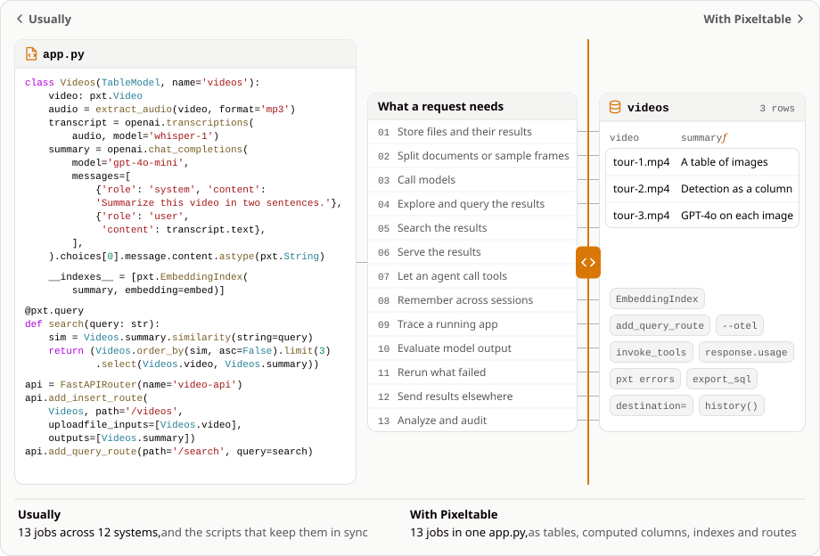

<picture>
  <source media="(prefers-color-scheme: dark)" srcset="https://raw.githubusercontent.com/pixeltable/pixeltable/main/docs/_hero/logo-dark.svg">
  
</picture>

# The backend agents build with

### Multimodal database, orchestration, and serving in one file, by the co-creators of Apache Parquet and Impala.

Pixeltable is an open-source multimodal database you use from Python. Build AI apps on video, images, audio and documents without writing scripts to keep files, model outputs and search indexes in sync.

```bash
pip install -U 'pixeltable[serve]'
```

[**Quickstart**](https://docs.pixeltable.com/overview/quick-start) |
[**Documentation**](https://docs.pixeltable.com/) |
[**CLI**](https://docs.pixeltable.com/platform/cli) |
[**Cloud**](https://docs.pixeltable.com/cloud) |
[**Discord**](https://discord.gg/QPyqFYx2UN) |
[**For agents**](https://www.pixeltable.com/get-started.md)

[](https://opensource.org/licenses/Apache-2.0)
[](https://github.com/pixeltable/pixeltable/actions/workflows/pytest.yml?query=branch%3Amain)
[](https://github.com/pixeltable/pixeltable/actions/workflows/nightly.yml)
[](https://github.com/pixeltable/pixeltable/actions/workflows/stress-tests.yml)
[](https://pypi.org/project/pixeltable/)
[](https://pypi.org/project/pixeltable/)

<picture>
  <source media="(max-width: 600px) and (prefers-color-scheme: dark)" srcset="https://raw.githubusercontent.com/pixeltable/pixeltable/main/docs/_hero/stack-slider-narrow-dark.svg">
  <source media="(max-width: 600px)" srcset="https://raw.githubusercontent.com/pixeltable/pixeltable/main/docs/_hero/stack-slider-narrow-light.svg">
  <source media="(prefers-color-scheme: dark)" srcset="https://raw.githubusercontent.com/pixeltable/pixeltable/main/docs/_hero/stack-slider-dark.svg">
  
</picture>

You declare tables, computed columns and HTTP routes in `app.py`. Insert a row and Pixeltable runs the computations, stores the results and updates the indexes.

You can also use Pixeltable directly from Python or a notebook without an HTTP server. Start with the [10-minute tour](https://docs.pixeltable.com/overview/ten-minute-tour).

## What it looks like

Upload a recording with speech. This API extracts its audio, transcribes it, summarizes what was said and indexes the summary for search. Save this as `app.py`:

```python
import pixeltable as pxt
from pixeltable.functions import openai
from pixeltable.functions.video import extract_audio
from pixeltable.serving import FastAPIRouter

TableModel = pxt.model_base()
embed = openai.embeddings.using(model='text-embedding-3-small')


class Videos(TableModel, name='videos'):
    video: pxt.Video  # the only column you insert; the rest run on insert

    audio = extract_audio(video, format='mp3')
    transcript = openai.transcriptions(audio, model='whisper-1')
    summary = openai.chat_completions(
        model='gpt-4o-mini',
        messages=[
            {'role': 'system', 'content': 'Summarize this video in two sentences.'},
            {'role': 'user', 'content': transcript.text},
        ],
    ).choices[0].message.content.astype(pxt.String)

    __indexes__ = [pxt.EmbeddingIndex(summary, embedding=embed)]


@pxt.query
def search(query: str):
    sim = Videos.summary.similarity(string=query)
    return Videos.order_by(sim, asc=False).limit(3).select(Videos.video, Videos.summary)


api = FastAPIRouter(name='video-api')
api.add_insert_route(Videos, path='/videos', uploadfile_inputs=[Videos.video], outputs=[Videos.summary])
api.add_query_route(path='/search', query=search)
```

You need Python 3.11 or later and an OpenAI API key. From the same folder, run:

```bash
pip install -U 'pixeltable[serve]' openai
export OPENAI_API_KEY=sk-...        # set this before the first pxt command
pxt init                            # makes this folder a project
pxt schema update app.py my_app     # creates the table and its index
pxt service update app.py my_app    # starts the service and prints its URL
```

Replace `PORT` with the printed port and `talk.mp4` with your recording:

```bash
curl -F video=@talk.mp4 http://127.0.0.1:PORT/videos
# {"summary": "..."}
curl -X POST http://127.0.0.1:PORT/search -H 'Content-Type: application/json' -d '{"query": "pricing"}'
# {"rows": [{"video": "...", "summary": "..."}]}
```

Uploading more recordings processes only the new rows. Pixeltable runs model calls concurrently, throttles requests using provider-reported or configured limits, and retries rate-limit errors.

### Change the summary without redoing transcription

Say the summaries are too long. Change the system prompt in `app.py` to `Summarize this video in one sentence.`, then run:

```bash
pxt schema update app.py my_app
pxt service update app.py my_app
pxt recompute my_app/videos summary
```

New uploads use the new prompt after the service restarts. Existing rows keep their summaries until you recompute `summary`, which also updates its search index. The audio and transcripts stay.

[How it works](https://docs.pixeltable.com/overview/how-it-works) covers dependencies, row errors, selective retries and table versions.

## Why we built it

Multimodal AI projects kept needing the same stack: a bucket, a metadata database, an orchestrator, vector search and an API. Each piece is fine on its own. The trouble is in between: a sync script that hopes the bucket and the database still match, and a vector database still serving embeddings of last week's summaries.

We're database people, so our answer was to make the database track dependencies and run the work.

| You need to | Usually | With Pixeltable |
|---|---|---|
| Store files and their results | A bucket plus a metadata table | Typed file references and computed results in the same row |
| Split documents or sample frames | A preprocessing job | Views of chunks or frames, updated with the source table |
| Call models | Jobs and scripts that track what ran | Computed columns with stored results |
| Explore and query the results | Scripts that download the files and redo the frames in a notebook | Query any column from Python or a notebook. Remote files go into a local cache on first read, and frames are extracted from the video as you read them |
| Search the results | A vector database you keep in sync | An embedding index maintained by the table |
| Serve the results | API handlers over those systems | `FastAPIRouter` routes declared next to the tables |
| Let an agent call tools | An agent loop that keeps its state in memory | A computed column runs the tools the model picked (`invoke_tools`), and the calls and their results are columns on the message's row |
| Remember across sessions | A chat-history cache and a second vector store | A memory table with an embedding index, recalled by a `@pxt.query` in a computed column |
| Trace a running app | A tracing SDK per vendor, with logs somewhere else | OpenTelemetry spans for each table, row, column and UDF (`pxt service update --otel`, `pixeltable[otel]`) |
| Evaluate model output | Model outputs copied out of logs into an eval notebook | Store the model's full response as a JSON column and query its fields (`response.usage`). An eval is one more computed column |
| Rerun what failed | A dead-letter queue and a script to replay it | Cells that fail under `on_error='ignore'` keep their error. `pxt errors` lists them (the table needs a primary key) and prints the `pxt recompute --errors-only` that reruns just those. `pxt computed` shows each column's definition |
| Send results elsewhere | An ETL job into another database, and a sync to the bucket | `export_sql()` or `export_parquet()` copies a table or query out. A computed column's `destination=` writes its files to your own bucket |
| Analyze and audit | A warehouse export, and history rebuilt from logs | Query the tables where they are. Each change is a version (`history()`, `pxt revert`) |

If you already use Pinecone, Postgres, LangGraph or Airflow, [Migrate to Pixeltable](https://docs.pixeltable.com/howto/coming-from) shows how the corresponding work looks here.

## What you can build

- [RAG over documents](https://docs.pixeltable.com/use-cases/multimodal-backend), with chunks and embeddings updated as documents arrive or leave.
- [Video and image pipelines](https://docs.pixeltable.com/use-cases/media-processing), with frames, transcripts and detections.
- [Agents](https://docs.pixeltable.com/use-cases/agentic-workflows) whose tool calls and results are columns you can query later.

Pixeltable fits best when files or prompts keep changing. If you don't want a typed schema, it's the wrong tool. It won't make your models better, and evaluation is still yours to manage. [Why Pixeltable](https://docs.pixeltable.com/overview/pixeltable) goes into the trade-offs.

## Start from an example

For a fresh project, `pxt service example --out app.py` writes an app that needs no model key. Follow the [quickstart](https://docs.pixeltable.com/overview/quick-start) to run it in a separate project folder.

Browse [complete apps](https://github.com/pierrebrunelle/awesome-pixeltable-apps), or follow [HTTP serving](https://docs.pixeltable.com/howto/deployment/serving) for uploads and TypeScript calls.

### With a coding agent

```bash
npx skills add pixeltable/pixeltable-skill
# or, from the root of your repo, with only Python:
pxt skills install
```

The [skill](https://github.com/pixeltable/pixeltable-skill) teaches your agent to write `app.py`, so you can review the backend change in one diff. [AI coding agents](https://docs.pixeltable.com/overview/building-pixeltable-with-llms) covers plugins for Claude, Cursor and ChatGPT, and MCP setup.

## Where it runs

- Locally, with the commands above. Uploaded and generated media go to local disk or [your own S3, GCS or Azure bucket](https://docs.pixeltable.com/integrations/cloud-storage).
- On your infrastructure, from Python, inside your own FastAPI app, or with `pxt service`. [Self-hosting](https://docs.pixeltable.com/howto/deployment/overview) covers each option.
- On [Pixeltable Cloud](https://docs.pixeltable.com/cloud), with the same `app.py`, a hosted database and managed media storage. Without an account, `pxt new` creates a free trial and prints its expiry and claim link.

## Contributing

Bug reports and PRs are welcome: [CONTRIBUTING.md](https://github.com/pixeltable/pixeltable/blob/main/CONTRIBUTING.md). Questions go to [Discord](https://discord.gg/QPyqFYx2UN) or [GitHub Discussions](https://github.com/pixeltable/pixeltable/discussions). Pixeltable is Apache 2.0.
